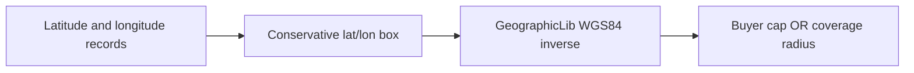

# Phase 1.2 — PostGIS-free geospatial prototype

This is a development prototype. It does not replace `search_marketplace_products` or `search_marketplace_services`, and it was not loaded onto Supabase or CloudHike.

**Prototype recommendation: PASS**

The local engine preserves the marketplace radius results against PostGIS 3.4.2 within the stated rules. That does not validate CloudHike. The migration gate remains **BLOCKED — NOT VERIFIED** until an isolated CloudHike development database runs the same cases and the design is explicitly approved. Phase 2 and the authentication migration stay stopped.

Measured 28 October 2026, 14:44 Africa/Luanda.

## Architecture



| Piece | Role |
| --- | --- |
| `src/lib/geospatial/wgs84-distance.ts` | Karney inverse on WGS84. Metres, full precision. |
| `src/lib/geospatial/radius-bounds.ts` | Candidate box. Not a distance test. |
| `src/lib/geospatial/postgis-free-search.ts` | Development search harness. |
| `src/lib/geospatial/polygon-relations.ts` | Planar polygon checks for a future delivery-zone boundary. Marketplace search does not call it. |
| `scripts/cloudhike/geospatial-prototype-bench.mts` | In-memory timings and a local Postgres plan. |
| Live services | Still call the PostGIS RPCs, then the haversine seed fallback. |

The harness accepts a search latitude, longitude, buyer radius, and records that carry a coverage radius (seller radius or service radius). It returns candidate ids, included ids, the ellipsoidal distance in metres for candidates, the inclusion reason, and timing counts. There is no production route.

## Package verification

`geographiclib-geodesic` 2.2.0 is the maintained JavaScript port of GeographicLib by Charles Karney. The package is CommonJS. Its export object is `{ Geodesic, GeodesicLine, PolygonArea, Constants, Math, Accumulator }`. A native Node ESM named import fails. The module imports the default object and uses `Geodesic.WGS84`.

`Geodesic.WGS84.Inverse(lat1, lon1, lat2, lon2, Geodesic.DISTANCE)` returns `s12` in metres on the WGS84 ellipsoid (`a = 6378137`, `f = 1/298.257223563`). `Direct` places a point at a given azimuth and distance. PostGIS geography distance uses the same Karney method.

`@turf/turf` 7.4.0 was already installed. Polygon checks use `booleanContains`, `booleanIntersects`, `booleanTouches`, `booleanValid`, `kinks`, and `intersect`. Turf's `booleanOverlap` returns true when polygon edges merely intersect, including a shared boundary. The prototype does not use it. PostGIS `ST_Overlaps` is false for that shared edge.

## Distance rules

The reference is the marketplace SQL, not the in-memory fallback.

1. Distance is the WGS84 ellipsoidal length in metres. Nothing rounds it before the comparison. The returned value keeps that precision.
2. Inclusion is `distance <= buyer cap` OR `distance <= coverage`. The buyer cap is `LEAST(buyerRadiusKm, 200) * 1000`. A null coverage radius is 50 km. The boundary counts as inside.
3. A search with coordinates and a buyer radius excludes records with null, non-finite, or otherwise unusable coordinates.
4. Omitting either search coordinate skips the spatial predicate, which matches `p_latitude IS NOT NULL AND p_longitude IS NOT NULL`.
5. A search point with a null buyer radius also skips the predicate, even when coordinates are present. The Phase 1.1 report described the omitted-coordinate case. The SQL does both, and the prototype follows the SQL.
6. Out-of-range marketplace coordinates are coerced the way PostGIS 3.4.2 coerces a `geography` cast: latitude reflects through ±90° (`95` becomes `85`, longitude unchanged) and longitude wraps into [-180, 180] (`200` becomes `-160`, `-540` becomes `180`). `get_nearby_*` still raises before that cast. The prototype does not merge those two behaviours. `nearbyCoordinateRejection` records the nearby rejection separately.
7. Non-finite search coordinates are refused. They are not treated as an omitted point.

One measured difference remains inside the inclusion test. For the latitude and longitude of the PostGIS 50.000 km point, GeographicLib 2.2.0 returned 50000.00000000012 m. PostGIS `ST_Distance` returned 50000 m and `ST_DWithin` was true. A raw `<=` excludes that point. The prototype treats a distance as inside when it exceeds the radius by at most `INCLUSION_EPSILON_METRES` (1e-6 m, 0.001 mm). A point 1 mm outside stays outside. The stored distance is still the raw GeographicLib value. The live differential test, which compares inclusion booleans with PostGIS, passed with this rule.

The in-memory fallback in `shopping-service.ts` and `marketplace-service.ts` is a different algorithm and was left in place. It uses haversine with `R = 6371`, treats a latitude or longitude of 0 as missing, and does not apply the SQL OR. It is not the reference.

## Candidate box

For radius `R` metres, with WGS84 equatorial radius `a` and eccentricity `e`:

- Meridional radius is at least `M(0) = a(1-e²)`. Latitude cannot change by more than `R / M(0)` radians.
- On that latitude band, the parallel radius `ρ(φ) = N(φ) cos φ` is smallest nearest a pole. Longitude cannot change by more than `R / ρ_min` radians.
- If the band reaches a pole, or the longitude span is at least 180°, every longitude is a candidate.
- Otherwise a span that crosses ±180° becomes two ranges.
- The radius used for the box is the maximum of the capped buyer radius and every record's coverage radius, plus 1 metre and 1e-8 degrees.

A point whose ellipsoidal distance is within `R` cannot fall outside that box. The unit test checks boundary points, polar searches, antimeridian searches, and 300 deterministic samples per centre and radius. The 2,000-record catalogue test requires every full-scan hit to appear in the candidate set.

The indexed form, for a single longitude range, is:

```sql
WHERE latitude BETWEEN :lat_min AND :lat_max
  AND longitude BETWEEN :lon_min AND :lon_max
```

`scripts/cloudhike/geospatial-prototype.sql` creates `proto_places(latitude, longitude, coverage_radius_km)` and a btree on `(latitude, longitude)`. One very large coverage radius widens the box for the whole query.

## Correctness

`src/test/geospatial-postgis-live.test.ts` ran against local database `geospatial_baseline` (PostGIS 3.4.2, socket only). It rebuilt each `ST_Project` point from `ST_X` / `ST_Y`, which is what the geography trigger stores, and compared the prototype.

| Case | Result |
| --- | --- |
| Buyer radius 10 km | Same included ids as `ST_DWithin` OR the coverage radius. `n_10` is inside both radii. `n_49_9` and `n_50` are inside the 50 km coverage radius only. `n_50_1`, `n_80`, `n_190`, and `n_210` are outside. |
| Buyer radius 100 km | `n_80` included by the buyer radius. |
| Buyer radius 250 km | Capped at 200 km. `n_190` included. `n_210` excluded. |
| Missing coordinates | Excluded while the predicate is on. Included when the predicate is skipped. |
| Latitude 95 | Coerced to latitude 85, same longitude. Distance from Luanda agrees with `ST_Distance` within 1 m and is outside 200 km. |
| Longitude 200 | Coerced to -160. |
| Exact 50 km and 50 km + 1 mm | Boundary included. One millimetre outside excluded. |
| Zero distance | 0 m, included. |
| Antimeridian and pole | Direct and inverse agree within 0.0001 m. The box keeps the boundary point and, at the pole, stops filtering longitude. |
| Candidate false negatives | None in the deterministic samples or the 2,000-record scan. |

Polygon checks are separate from search. On the Phase 1.1 square:

| Case | `contains` | `intersects` |
| --- | --- | --- |
| Interior | true | true |
| Boundary | false | true |
| Exterior | false | false |

A shared edge intersects and touches, and the area overlap is false, matching `ST_Intersects`, `ST_Touches`, and `ST_Overlaps` on that pair. A bowtie is invalid, matching `ST_IsValid`. An antimeridian ring is interpreted as planar longitude/latitude, the same reading as `geometry(Polygon, 4326)`: the long planar span through the prime meridian contains longitude 0 and does not contain longitude 179. This is not a geodesic polygon, and marketplace search does not use it.

## Performance

Catalogue: uniform points over latitude -18 to -2 and longitude 11 to 24, coverage radius 50 km, search at Luanda with a 50 km buyer radius. Both radii are 50 km, so the box is the 50 km conservative bound. Timings are one run of `scripts/cloudhike/geospatial-prototype-bench.mts` in this environment.

| Records | Candidates | Final matches | Full-scan matches | Candidate selection | Exact distance | Filtered total | Full scan |
| --- | ---: | ---: | ---: | ---: | ---: | ---: | ---: |
| 1,000 | 3 | 3 | 3 | 0.275 ms | 1.696 ms | 2.627 ms | 18.427 ms |
| 10,000 | 38 | 27 | 27 | 2.091 ms | 1.187 ms | 7.451 ms | 31.202 ms |
| 100,000 | 385 | 284 | 284 | 13.119 ms | 19.831 ms | 62.637 ms | 141.725 ms |

After the 100,000-row search, heap use was 46.7 MB and RSS was 152 MB. Full-scan match counts equalled the filtered match counts, so this catalogue had no candidate false negatives.

The same 100,000 rows were loaded into local database `geospatial_proto` (`inet_server_addr()` null). `EXPLAIN (ANALYZE, BUFFERS)` on the conservative box:

- Bitmap index scan on `proto_places_lat_lon_idx`, 385 rows, execution 0.929 ms.
- The same predicate with index and bitmap scans disabled: sequential scan, 99,615 rows removed, execution 5.507 ms.

`cube` and `earthdistance` are available on that local server. `earth_distance` of one degree of longitude at the equator was 111,320.032 m, so the unit is metres. `earth_box(..., 50000)` missed no included row of the Angola sample. It did miss 8 of 64 points placed on the ellipsoidal boundary: due north and due south of the equator at 50 km (sphere excess 337.2 m) and at 200 km (sphere excess 1,348.2 m). A spherical cube at the true radius is not a safe prefilter. The prototype does not use it for inclusion or for candidate selection.

A 100,000-row Angola-sized catalogue is comfortable in process and in a local btree lookup. The approach is suitable for the current marketplace volume and for a catalogue of this size. It is not a substitute for measuring the real row count, and a single unbounded coverage radius makes the box large.

## What a later integration would change

Not implemented:

- `ShoppingService.searchProducts` would keep its filters and response shape, obtain candidates with the latitude/longitude box, and set distance from `wgs84DistanceMetres` instead of `ST_Distance`. The RPC's `distance_km` is currently rounded to one decimal in the service after the query.
- `MarketplaceService.searchServices` would do the same for `service_radius_km`.
- The SQL functions `search_marketplace_products` and `search_marketplace_services` would stop requiring `geography` for the radius predicate, or a SQL box would prefilter and the service would finish the ellipsoidal test.
- `get_nearby_*` would stay on its own invalid-coordinate rejection unless a separate change says otherwise.
- Delivery-zone polygons would use `polygon-relations.ts` only when a boundary is actually queried. The seed leaves `boundary` null.
- The haversine fallback would be retired in that same change so the two paths stop disagreeing.

## Limitations

- CloudHike project `agroconnect` has no development database and no PostGIS. This prototype was not executed there. btree and `earthdistance` behaviour on that server was not re-measured in this phase; the plans above are local.
- Distances for records outside the candidate box are not calculated. Inclusion for those records is false.
- The 1e-6 m inclusion allowance is an explicit float bridge, not a change to the 50 km rule.
- Polygon overlap is demonstrated on the baseline squares. It is not a full DE-9IM proof, and it is not on the live search path.
- Production row counts were not used. The synthetic catalogue is uniform over a rectangle that covers Angola.

## Recommendation

**PASS** for this local prototype: included ids and booleans matched PostGIS on the baseline cases, distances stayed inside 1 metre, and the latitude/longitude box added no false negatives.

**Path B is ready for review and is not approved.** Approving it means accepting the 1e-6 m inclusion bridge, the coerce-not-reject marketplace coordinate rule, planar polygons for any future delivery boundary, and a btree box sized to the largest coverage radius in the query.

The migration gate stays **BLOCKED — NOT VERIFIED**. Do not start Phase 2, change Clerk, migrate identity data, or point production traffic at CloudHike.
