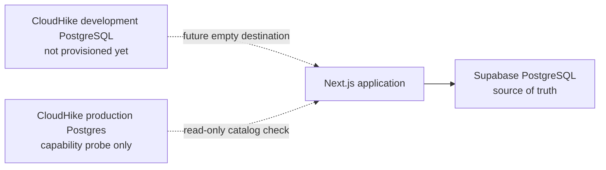

# Phase 1 — CloudHike infrastructure and database foundation

Phase 1 prepares CloudHike PostgreSQL as a future destination. The running application still uses Supabase PostgreSQL, Clerk, and Supabase Storage. Nothing in this phase switches traffic, copies production rows, or writes from the app to CloudHike.

## Architecture



| Path | Role in Phase 1 |
| --- | --- |
| Application to Supabase | Unchanged. `@supabase/supabase-js`, Clerk, storage, and the PWA stay as they are. |
| CloudHike development database | The intended isolated destination. The development environment does not exist yet. |
| CloudHike production Postgres on project `agroconnect` | Already provisioned during the PostGIS investigation. Used only to read `pg_available_extensions`. No schema and no AgriConnect rows were loaded. |

There are no dual writes. Application code does not read `DATABASE_URL` or `DIRECT_URL`.

### Production cutover boundary

A production cutover is out of scope. It stays blocked until all of the following are true:

1. PostGIS is available on the CloudHike image, or a reviewed schema change preserves the current spatial behavior without dropping it.
2. A development database has loaded the reviewed schema from empty and passed the checks in `migration-runbook.md`.
3. Row Level Security no longer depends on Supabase `auth.jwt()`, `auth.role()`, or the `anon` / `authenticated` / `service_role` roles.
4. Storage policies against `storage.buckets` and `storage.objects` have a replacement. That replacement is not part of this phase.
5. Identity cutover is a later phase. `profiles.clerk_user_id` stays the legacy key. Passwords and sessions are not copied.
6. Production row counts, null subscription plans, and file checksums are compared under a write freeze. That comparison has not been done.

## Provisioned resources

Checked 28 October 2026, 13:54 Africa/Luanda, through the CloudHike integration.

| Resource | State |
| --- | --- |
| Project | `agroconnect`, slug `agroconnect-8shmts`, id `01c957fd-8d87-422c-8db9-9a66eddb87a1`. Created 28 October 2026, 13:19 Africa/Luanda. |
| Production Postgres | Ready. PostgreSQL 16.15, Alpine musl. Database name uses the Free shared-server `p_` pattern. Role is not a superuser. |
| Development environment | Absent. CloudHike returns: the user creates it from the dashboard switcher. |
| Auth, Storage, Redis, Email, Jobs | Not deployed. |
| Plan upgrade | Not performed. |

Dashboard: https://cloudhike.dev/dashboard/projects/agroconnect-8shmts

A development environment is a second database with its own credentials. On the Free plan that database is 500 MB, allows 30 connections, times out statements at 30 seconds, and sleeps after 6 hours without a connection. This phase does not create it, because the dashboard action is required and a second database consumes plan quota.

### Create the isolated development database

1. Open the project dashboard linked above.
2. Use the environment switcher under the project name and add Development. Development pages are tagged, and the URL becomes `/dashboard/projects/agroconnect-8shmts-dev`.
3. On the development Services tab, deploy Postgres only. Do not deploy Auth or Storage in this phase.
4. From the development Environment tab, copy `DATABASE_URL` and `DIRECT_URL` into `.env.cloudhike.local` at the repository root. That file is git-ignored.
5. Run `npm run cloudhike:check`.

Do not paste those values into `.env.example`, `.env.local`, chat, or a commit. Do not point the existing Supabase variables at CloudHike.

The production Postgres that already exists is a capability probe. Do not replay migrations into it.

## Connection

Official CloudHike names, confirmed present on the production probe (`get_environment` format `names`):

| Variable | Use | Browser |
| --- | --- | --- |
| `DATABASE_URL` | Pooled queries through PgBouncer. One transaction per borrowed connection. | No |
| `DIRECT_URL` | Migrations, `pg_dump`, `LISTEN` / `NOTIFY`, session `SET`, and advisory locks. | No |

The CloudHike Postgres guide recommends `pg` (`node-postgres`) with the connection string taken from the environment. `scripts/cloudhike/check-destination.mjs` follows that. It connects with `DIRECT_URL`, runs one catalog query, and exits. It does not execute files from `supabase/migrations`.

`sslmode=require` is part of the connection string when CloudHike TLS is on. The script does not invent a host.

## Security

- Database URLs stay server-side. They are not `NEXT_PUBLIC_` variables.
- `.env.cloudhike.local` is listed in `.gitignore`. `.env.example` contains commented placeholders only.
- The check script redacts `postgresql://` strings from connection errors before printing them.
- Supabase and Clerk variables in `.env.example` are unchanged.
- Provider credentials for ImageKit, Bunny, payments, and OpenAI are unchanged on this branch.

## Backups and recovery

CloudHike takes a nightly `pg_dump` at 02:00. Without a Storage service, the dump goes to the platform backup bucket. Free retention is 7 days, Pro 30, Scale 90. Restore loads into a side database and swaps only after a full load. A failed restore leaves the current database in place.

Phase 1 has no AgriConnect data on CloudHike, so there is nothing to restore. Recovery for this phase is: leave the Next.js app on Supabase. Deleting a CloudHike database is irreversible and is a dashboard action. This phase does not delete the production probe.

## Validation commands

```bash
npm run cloudhike:inventory
npm run cloudhike:check
npm run typecheck
npm run lint
npm test
npm run build
```

`cloudhike:check` exits 1 until `.env.cloudhike.local` has both URLs. Against the current image it is expected to exit 2 with `POSTGIS_UNSUPPORTED` once a database is configured. Exit 2 means the catalog was read and no SQL was applied.
