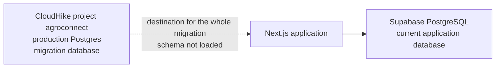

# Phase 1 — CloudHike infrastructure and database foundation

Phase 1 prepares CloudHike PostgreSQL as a future destination. The running application still uses Supabase PostgreSQL, Clerk, and Supabase Storage. Nothing in this phase switches traffic, copies production rows, or writes from the app to CloudHike.

## Architecture



| Path | Role |
| --- | --- |
| Application to Supabase | Still the database the running app reads and writes. Clerk, Supabase Storage, and the PWA stay as they are. |
| CloudHike project `agroconnect` | The only database for this migration. Production Postgres on that project. No second project and no development environment. |

There are no dual writes. Application code does not read `DATABASE_URL` or `DIRECT_URL`.

### Production cutover boundary

A production cutover is out of scope. It stays blocked until all of the following are true:

1. PostGIS is available on the CloudHike image, or a reviewed schema change preserves the current spatial behavior without dropping it.
2. This same CloudHike database has loaded the reviewed schema from empty and passed the checks in `migration-runbook.md`.
3. Row Level Security no longer depends on Supabase `auth.jwt()`, `auth.role()`, or the `anon` / `authenticated` / `service_role` roles.
4. Storage policies against `storage.buckets` and `storage.objects` have a replacement. That replacement is not part of this phase.
5. Identity cutover is a later phase. `profiles.clerk_user_id` stays the legacy key. Passwords and sessions are not copied.
6. Production row counts, null subscription plans, and file checksums are compared under a write freeze. That comparison has not been done.

## Provisioned resources

Checked 28 October 2026, 13:54 Africa/Luanda, through the CloudHike integration.

| Resource | State |
| --- | --- |
| Project | `agroconnect`, slug `agroconnect-8shmts`, id `01c957fd-8d87-422c-8db9-9a66eddb87a1`. Created 28 October 2026, 13:19 Africa/Luanda. |
| Production Postgres | Ready. This is the migration database. PostgreSQL 16.15, Alpine musl, Free shared server. The role is not a superuser. |
| Development environment | Not used. The whole migration stays on this project's production Postgres. |
| Auth, Storage, Redis, Email, Jobs | Not deployed. |
| Plan upgrade | Not performed. |

Dashboard: https://cloudhike.dev/dashboard/projects/agroconnect-8shmts

The CloudHike project name is `agroconnect`. There is no separate project named `agriconnect`. AgriConnect's migration uses this one database: 500 MB, 30 connections, a 30-second statement timeout, and sleep after 6 hours without a connection.

`.env.cloudhike.local` holds that database's `DATABASE_URL` and `DIRECT_URL`. The file is git-ignored. `npm run cloudhike:check` reads it and connects with `DIRECT_URL`. Do not paste the values into `.env.example`, `.env.local`, chat, or a commit. Do not point the Supabase variables at CloudHike. The Next.js app keeps using Supabase until this database can load the spatial schema.

## Connection

Official CloudHike names, confirmed on project `agroconnect` (`get_environment` format `names`):

| Variable | Use | Browser |
| --- | --- | --- |
| `DATABASE_URL` | Pooled queries through PgBouncer. One transaction per borrowed connection. | No |
| `DIRECT_URL` | Migrations, `pg_dump`, `LISTEN` / `NOTIFY`, session `SET`, and advisory locks. | No |

The CloudHike Postgres guide recommends `pg` (`node-postgres`) with the connection string taken from the environment. `scripts/cloudhike/check-destination.mjs` follows that. It connects with `DIRECT_URL`, runs one catalog query, and exits. It does not execute files from `supabase/migrations`.

`sslmode=require` is part of the connection string when CloudHike TLS is on. The script does not invent a host.

## Security

- Database URLs stay server-side. They are not `NEXT_PUBLIC_` variables.
- `.env.cloudhike.local` is listed in `.gitignore`. `.env.example` contains commented placeholders only.
- The check script redacts `postgresql://` strings from connection errors before printing them.
- Supabase and Clerk variables in `.env.example` are unchanged.
- Provider credentials for ImageKit, Bunny, payments, and OpenAI are unchanged on this branch.

## Backups and recovery

CloudHike takes a nightly `pg_dump` at 02:00. Without a Storage service, the dump goes to the platform backup bucket. Free retention is 7 days, Pro 30, Scale 90. Restore loads into a side database and swaps only after a full load. A failed restore leaves the current database in place.

This CloudHike database has no AgriConnect tables yet, so there is nothing to restore. Recovery is: leave the Next.js app on Supabase. Deleting the CloudHike database is irreversible and is a dashboard action. This phase does not delete it.

## Validation commands

```bash
npm run cloudhike:inventory
npm run cloudhike:check
npm run typecheck
npm run lint
npm test
npm run build
```

`cloudhike:check` was run against project `agroconnect` on 28 October 2026 (afternoon, Africa/Luanda). It connected and exited 2 with `POSTGIS_UNSUPPORTED`. The catalog was read and no SQL was applied.
